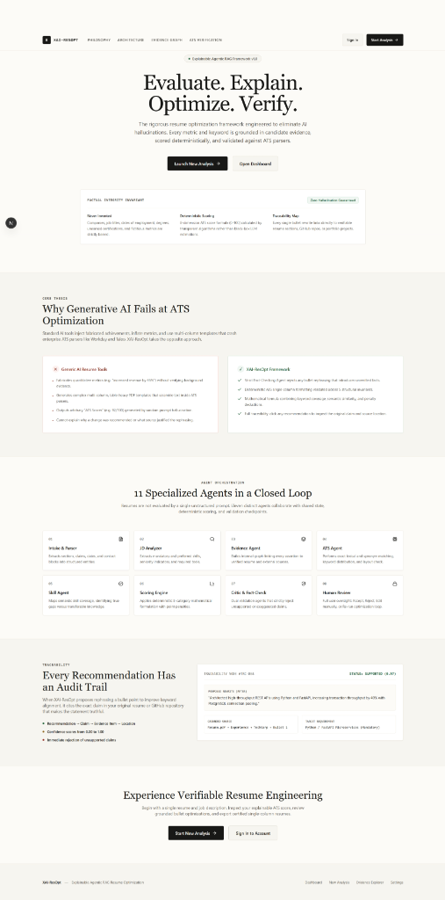
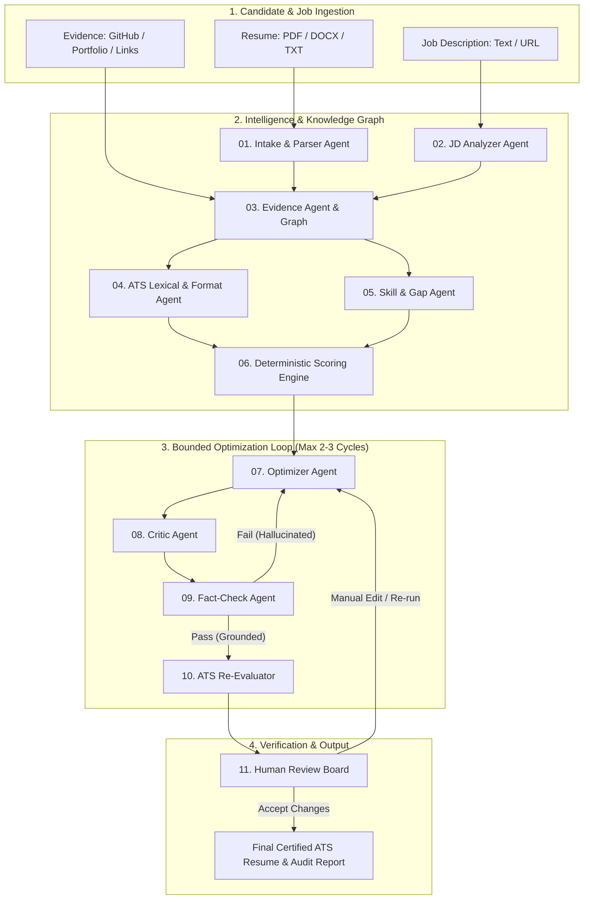
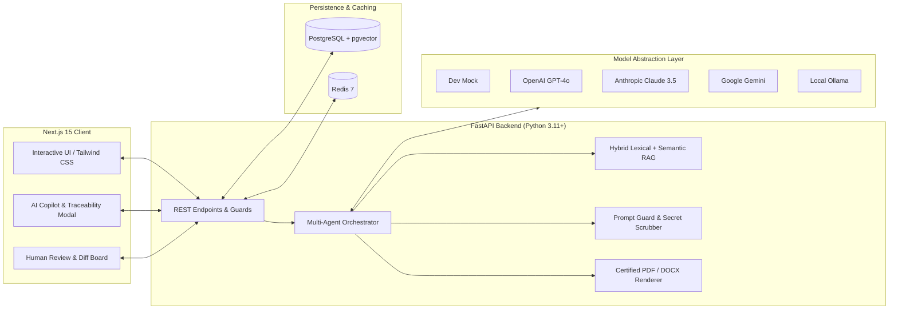

# XAI-ResOpt

<div align="center">

### Explainable, Evidence-Backed AI Resume Evaluation & Optimization Framework

[](https://fastapi.tiangolo.com)
[](https://nextjs.org)
[](https://www.postgresql.org)
[](https://redis.io)
[](https://www.python.org)
[](https://www.typescriptlang.org)
[](LICENSE)

*The rigorous resume optimization framework engineered to eliminate AI hallucinations. Every metric and keyword is grounded in candidate evidence, scored deterministically, and validated against ATS parsers.*

---



</div>

---

## Table of Contents

- [The Core Problem](#-the-core-problem)
- [Factual Integrity Invariants](#-factual-integrity-invariants)
- [Working System Architecture](#-working-system-architecture)
  - [1. End-to-End Closed-Loop Workflow](#1-end-to-end-closed-loop-workflow)
  - [2. Component & Runtime Architecture](#2-component--runtime-architecture)
- [11 Specialized Agents](#-11-specialized-agents)
- [Traceability & Audit Trail](#-traceability--audit-trail)
- [Tech Stack](#-tech-stack)
- [Getting Started](#-getting-started)
  - [Prerequisites](#prerequisites)
  - [Quick Start with Docker Compose](#quick-start-with-docker-compose)
  - [Running Locally without Docker](#running-locally-without-docker)
- [Testing & Quality Assurance](#-testing--quality-assurance)
- [Repository Structure](#-repository-structure)

---

##  The Core Problem

Most AI resume tools inject fabricated metrics (e.g. *"increased revenue by 400%"*), hallucinate credentials, and output complex multi-column layouts that break enterprise ATS engines (Workday, Taleo, Greenhouse).

| Generic AI Resume Tools | XAI-ResOpt Framework |
| :--- | :--- |
| ❌ Fabricates metrics and responsibilities without source proof |  **Strict Fact-Checking Agent** rejects any claim lacking candidate evidence |
| ❌ Generates multi-column, icon-heavy templates that choke ATS parsers |  **Deterministic single-column formatting** validated against structural ATS invariants |
| ❌ Outputs arbitrary, black-box scores generated by random LLM prompts |  **Mathematical 8-dimension scoring formula** (0–100) with transparent point deductions |
| ❌ Cannot explain why changes were made or link them back to reality |  **Full Bidirectional Traceability**: Every recommendation links to an exact source claim |

---

##  Factual Integrity Invariants

1. **Never Invented**: Companies, job titles, dates of employment, degrees, unearned certifications, and fictitious metrics are strictly barred.
2. **Deterministic Scoring**: An 8-dimension ATS score formula (0–100) calculated by mathematical algorithms rather than stochastic LLM prompts.
3. **Traceability Map**: Every single bullet rewrite links directly to verifiable resume sections, GitHub repos, or portfolio projects.

---

## 🏗 Working System Architecture

### 1. End-to-End Closed-Loop Workflow



### 2. Component & Runtime Architecture



---

## 🤖 11 Specialized Agents

| # | Agent Name | Core Responsibility |
| :---: | :--- | :--- |
| **01** | **Intake & Parser** | Deterministically parses text/PDF/DOCX, extracts contact blocks, work entries, dates, and structures entities. |
| **02** | **JD Analyzer** | Classifies job requirements into mandatory, preferred, nice-to-have, seniority levels, and tools. |
| **03** | **Evidence Agent** | Builds candidate knowledge graph; verifies claims against resume and external proofs (GitHub, portfolio). |
| **04** | **ATS Agent** | Computes lexical keyword coverage, standard section naming, layout compliance, and formatting risks. |
| **05** | **Skill Agent** | Maps candidate abilities against market taxonomy, distinguishing exact matches from transferable skills. |
| **06** | **Scoring Engine** | Applies deterministic 8-category mathematical formulation with point penalties (no LLM hallucination). |
| **07** | **Optimizer Agent** | Proposes targeted bullet, summary, and skill rewrites using **only** verified candidate evidence. |
| **08** | **Critic Agent** | Evaluates proposed changes for brevity, professional voice, active verbs, and keyword naturalness. |
| **09** | **Fact-Check Agent** | Strict adversarial validator: compares every proposed bullet to evidence graph; rejects unverified claims. |
| **10** | **ATS Re-Evaluator** | Re-scores the modified resume to calculate exact before/after score delta and verify improvements. |
| **11** | **Human Review** | Empowers the candidate with complete control: Accept, Reject, Edit inline, or re-run the loop. |

---

## 🔍 Traceability & Audit Trail

Every recommendation and bullet rewrite contains an unbroken audit trail:

```
[Target Requirement]
└── Python / FastAPI Microservices (Mandatory)
    └── [Grounded Source]
        └── resume.pdf → Experience → TechCorp → Bullet 1
            └── [Status]
                └── SUPPORTED (Confidence: 0.97)
                    └── [Proposed Rewrite]
                        └── "Architected high-throughput REST APIs using Python and FastAPI, 
                             increasing transaction throughput by 40% with PostgreSQL connection pooling."
```

If an AI suggestion cannot be resolved to a specific source in the candidate's original resume or verified external portfolio, it is **instantly rejected** before reaching the user.

---

## 💻 Tech Stack

- **Frontend**: Next.js 15 (App Router), React 19, TypeScript, Tailwind CSS, Lucide Icons, TanStack React Query
- **Backend**: FastAPI, Pydantic v2, Python 3.11+, Alembic, SQLAlchemy 2.0 (Async)
- **Database & Storage**: PostgreSQL with `pgvector` for semantic embeddings, Redis for caching & rate limiting
- **AI & RAG Engine**: Multi-provider adapter (OpenAI, Anthropic Claude, Google Gemini, Ollama, and Mock Dev Provider)
- **Document Generation**: Deterministic single-column ATS PDF & DOCX generation via `reportlab` & `python-docx`

---

## 🚀 Getting Started

### Prerequisites

- [Docker Desktop](https://www.docker.com/) (recommended) OR Python 3.11+ & Node.js 20+
- Git

### Quick Start with Docker Compose

1. **Clone the repository:**
   ```bash
   git clone https://github.com/sohyal-2/XAI-ResOpt.git
   cd XAI-ResOpt
   ```

2. **Configure environment:**
   ```bash
   cp .env.example .env
   ```

3. **Start all services:**
   ```bash
   docker compose up --build
   ```

4. **Access the application:**
   - **Frontend**: [http://localhost:3000](http://localhost:3000)
   - **Backend API & Swagger Docs**: [http://localhost:8000/docs](http://localhost:8000/docs)
   - **Health Check**: [http://localhost:8000/api/health](http://localhost:8000/api/health)

---

### Running Locally without Docker

#### 1. Backend Setup

```powershell
# Create & activate virtual environment
python -m venv .venv
.\.venv\Scripts\Activate.ps1

# Install dependencies
pip install -r backend\requirements.txt

# Run migrations (ensure PostgreSQL is running)
$env:PYTHONPATH = "backend"
alembic -c backend\alembic.ini upgrade head

# Start FastAPI development server
uvicorn app.main:app --app-dir backend --reload --port 8000
```

#### 2. Frontend Setup

```powershell
cd frontend
npm install
npm run dev
```

The frontend will run on [http://localhost:3000](http://localhost:3000).

---

## 🧪 Testing & Quality Assurance

Run the comprehensive test suite across unit, agent, RAG, and security layers:

```powershell
# Run backend tests
$env:PYTHONPATH = "backend"
pytest backend/tests -v

# Run security audit & prompt guard tests
pytest backend/tests/test_security_audit.py -v

# Run frontend typecheck & tests
cd frontend
npm run typecheck
npm test
```

---

## 📁 Repository Structure

```
XAI-ResOpt/
├── assets/                     # Screenshots and architecture diagrams
│   └── landing-page.png        # Web platform landing page
├── backend/                    # FastAPI Multi-Agent Engine
│   ├── app/
│   │   ├── ai/                 # LLM adapters (OpenAI, Gemini, Claude, Ollama) & prompt guards
│   │   ├── api/                # REST endpoints (auth, ingestion, analysis, review, tools)
│   │   ├── core/               # Configuration, security, rate limiting
│   │   ├── integrations/       # GitHub & external portfolio fetchers
│   │   ├── models/             # SQLAlchemy ORM models
│   │   ├── parsing/            # Deterministic resume & JD parsers
│   │   ├── rag/                # Agentic hybrid lexical + semantic retrieval
│   │   ├── schemas/            # Pydantic data schemas
│   │   ├── scoring/            # Deterministic 8-dimension scoring engine
│   │   └── services/           # Rendering (PDF/DOCX), review, observability
│   ├── migrations/             # Alembic database migrations
│   └── tests/                  # Pytest suite & security audit tests
├── docs/                       # Specifications & design documentation
│   ├── ARCHITECTURE.md         # System architecture & boundaries
│   ├── AGENTS.md               # Agent node specifications
│   ├── SCORING.md              # Scoring formulas & deductions
│   └── UI-UX.md                # Design system & accessibility rules
├── frontend/                   # Next.js 15 Web Application
│   ├── app/                    # App Router pages (Dashboard, Analysis, Review, Settings)
│   ├── features/               # Feature modules (analysis tabs, review board, auth)
│   └── lib/                    # Typed API client
└── docker-compose.yml          # Container configuration
```

---

## 📄 License

This project is licensed under the [MIT License](LICENSE).
